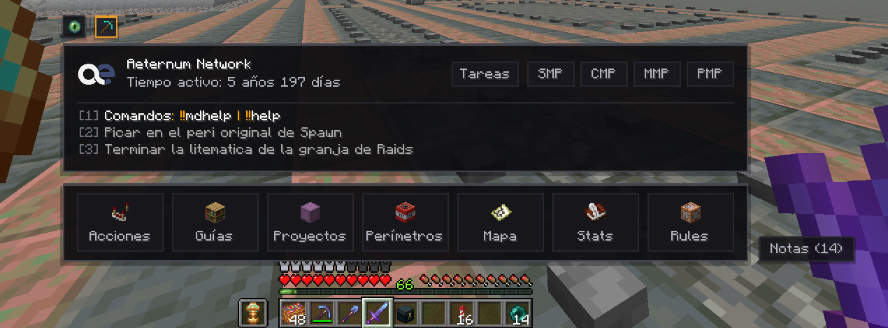

# Dock Rápido, Banner MOTD y Notas To-Do

El sistema de **Dock Rápido** centraliza los accesos a las interfaces de Aeternum Carpet, cambios rápidos de dimensión, modos personales y notas sobre la hotbar, sin escribir comandos.



---

## 1. Requisitos y Reglas Configurables

Todas estas reglas pertenecen a la categoría `AETERNUM` y se configuran con `/carpet <regla> <valor>` o desde `/rules`:

| Regla | Default | Valores | Qué habilita |
| --- | --- | --- | --- |
| `quickDock` | `false` | `true`, `false` | Activa la barra rápida sobre la hotbar al mantener la tecla **Aeternum Dock**. |
| `joinMotd` | `false` | `true`, `false` | Muestra el banner MOTD de Aeternum Network al entrar al servidor (5 segundos) y dentro del Dock. |
| `todoList` | `false` | `true`, `false` | Habilita las notas personales **To-Do** en el Dock y su modo pineado en pantalla. |
| `cameraMode` | `"off"` | `"off"`, `"on"`, `"restrictive"` | Muestra el botón rápido de `/cs` en el Dock si es distinto de `"off"`. |
| `carefulBreak` | `false` | `true`, `false` | Muestra el botón rápido de `/carefulbreak` en el Dock. |
| `commandDimension` | `false` | `true`, `false` | Muestra los botones de Overworld, Nether y End en el Dock (solo en Creativo o Espectador). |

> [!TIP]
> Si quieres que estas reglas persistan tras reiniciar el servidor, usa `/carpet setDefault <regla> <valor>` o activa **Guardar Default: SÍ** en `/rules`.

---

## 2. Controles y Tecla Configurable

- **Tecla por defecto:** `Left Alt` (`key.aeternum_carpet.quick_dock`).
- **Cómo cambiarla:** Ve a **Opciones → Controles → Asignación de teclas → categoría `Aeternum Carpet`** y reasigna la tecla del Dock.
- **Funcionamiento:** El Dock es **por pulsación sostenida** (*hold-to-open*). Mientras mantienes `Alt`, el cursor se desbloquea para hacer clic en cualquier botón; al soltar `Alt`, el Dock se cierra automáticamente.

---

## 3. Secciones del Dock

1. **Banner MOTD (`joinMotd`)**
   - Aparece automáticamente durante **5 segundos** al conectarte al servidor y permanece accesible dentro del Dock.
   - Muestra el logo de Aeternum, tiempo activo y la lista de tareas globales del servidor.
   - Botón **Tareas** (OPs): abre el editor `Tareas del MOTD` para agregar, reordenar (`▲` / `▼`), eliminar y dar formato a las tareas.
   - Botones de red/servidor (`SMP`, `CMP`, `MMP`, `PMP`) cuando estén configurados.
2. **Accesos a Interfaces**
   - Botones directos a **Acciones** (`/actions`), **Guías** (`/guide`), **Proyectos** (`/projects`), **Perímetros** (`/perimeter`), **Mapa** (`/exploration`), **Stats** (`/stats`) y **Rules** (`/rules`).
   - Cada botón solo aparece si la regla correspondiente está activa y tienes permiso para usarlo.
3. **Botones de Dimensión y Modos**
   - **Overworld / Nether / End:** Equivalen a `/overworld`, `/nether` y `/end` (requieren `commandDimension=true` y estar en Creativo o Espectador).
   - **Cámara (`/cs`):** Alterna entre tu modo supervivencia y espectador sin perder tu posición.
   - **CarefulBreak:** Alterna el modo de recolección directa al inventario (`off` / `sneak` / `always`).
4. **Notas Personales (`todoList`)**
   - Botón **Notas** en la esquina inferior derecha del Dock para desplegar/colapsar tu lista personal o crear una nota rápida (`+ Nota`).
   - Puedes **pinear** la lista para que permanezca visible en pantalla aunque cierres el Dock (la preferencia de colapsado/pineado se guarda en `config/aeternum-carpet/hud.json` en tu cliente).

---

## 4. Formato de Colores en Tareas del MOTD

El editor de tareas del MOTD soporta marcado con barra invertida (`\token`):

- **Colores:** `\black`, `\dark_blue`, `\dark_green`, `\dark_aqua`, `\dark_red`, `\dark_purple`, `\gold`, `\gray`, `\dark_gray`, `\blue`, `\green`, `\aqua`, `\red`, `\light_purple`, `\yellow`, `\white`
- **Estilos:** `\bold`, `\italic`, `\underline`, `\strikethrough`, `\obfuscated`, `\reset`

**Ejemplo:**
```text
\gold\bold[Evento]\reset \whiteTerminar la granja de Raids en \aquaOverworld
```
