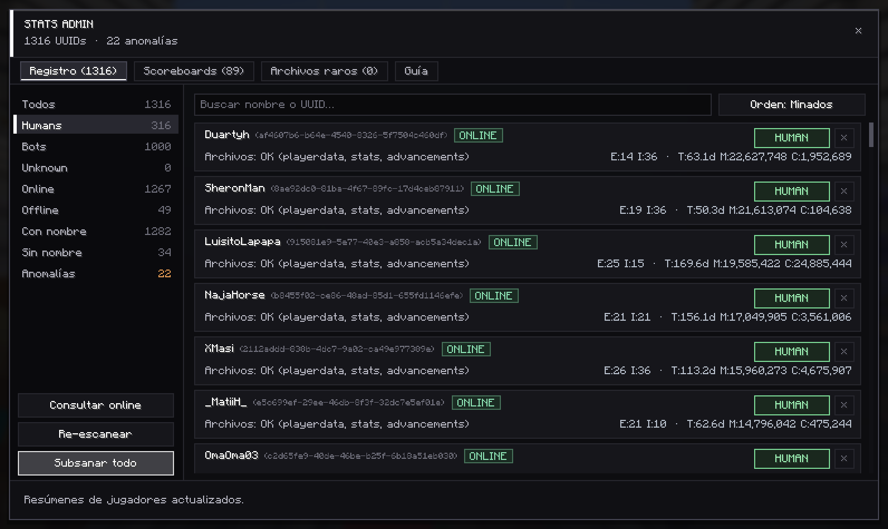
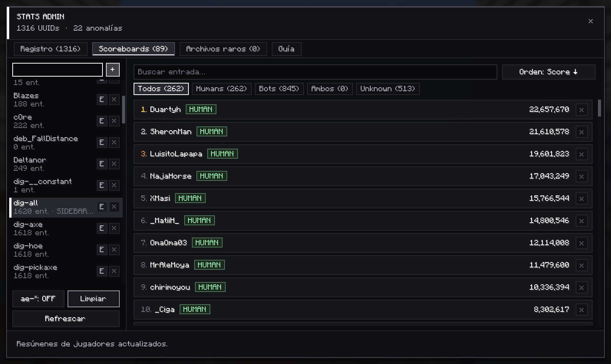

# Stats Admin (`/stats`)

Panel integral para administrar el registro de jugadores y bots, detectar y reparar archivos corruptos de jugador, gestionar scoreboards en caliente (incluyendo trackers custom y áreas por contorno) y exponer estadísticas en JSON por RCON.

| Registro de Jugadores | Scoreboards y Rankings |
| --- | --- |
|  |  |

---

## 1. Requisitos, Reglas y Permisos

| Elemento | Valor |
| --- | --- |
| **Regla Carpet** | `commandStats` (`false` por defecto) |
| **Comando principal (UI)** | `/stats` — Requiere **OP nivel 2** y ejecutarse desde el cliente. |
| **Comando para jugadores** | `/stats scoreboard <categoría> <stat>` y `/stats scoreboard hide` — Disponible para **todos los jugadores** cuando `commandStats=true`. |
| **API RCON (JSON)** | `/stats api ...` — Requiere **OP nivel 2** (ideal para bots de Discord o consola). |

---

## 2. Pestaña: Registro

### Clasificación y Filtros
En la barra lateral izquierda puedes filtrar por:
- **Tipo:** `Todos`, `Humans`, `Bots`, `Unknown`.
- **Estado:** `Online`, `Offline`, `Con nombre`, `Sin nombre`, `Anomalías`.

En la cabecera derecha puedes cambiar el criterio de ordenamiento: `Nombre`, `Sin nombre`, `Tipo`, `Online/Offline`, `Anomalías`, `Ender + Inv`, `Minados`, `Crafteados`, `Horas jugadas`.

### Resúmenes Cacheados
Cada tarjeta muestra métricas rápidas:
- `E:` Slots ocupados en Ender Chest (sobre 27).
- `I:` Slots ocupados en Inventario + armadura.
- `T:` Tiempo jugado.
- `M:` Bloques minados.
- `C:` Ítems crafteados.

### Detalle de Jugador
Haz clic en cualquier tarjeta para abrir su vista detallada:
- Estadísticas completas traducidas y formateadas.
- Inventario, armadura y Ender Chest con tooltips.
- Acceso directo al editor `/viewinv` (si está habilitado).
- Última posición registrada y clasificación manual (`HUMAN` / `BOT` / `UNKNOWN`).

### Detección y Subsanación de Anomalías
- **Consultar online / Mojang:** Resuelve nombres de UUIDs sin nombre consultando a Mojang.
- **Re-escanear:** Vuelve a analizar los archivos del mundo (`playerdata`, `stats`, `advancements`).
- **Subsanar anomalías / Subsanar todo:**
  - Restaura `.dat_old` si falta el archivo `.dat`.
  - Crea `stats` y `advancements` vacíos si existe `.dat`.
  - No inventa inventarios ni `.dat` desde cero.
  - Omite jugadores o bots que estén conectados en ese momento.

---

## 3. Pestaña: Scoreboards

### Gestión en Caliente
- **+ Nueva scoreboard:** Crea objetivos usando:
  - Stats vanilla de Minecraft (`mined`, `used`, `crafted`, `broken`, `picked_up`, `dropped`, `killed`, `killed_by`, `custom`).
  - **Trackers custom:** `aeternum:dig_all` (todo lo picado) y `aeternum:placed_blocks` (bloques colocados).
  - **Scoreboards por área:**
    - `Rectángulo`: delimitado por dos esquinas.
    - `Custom`: delimitado por contorno cerrado (hasta **1,000,000 de bloques**), evaluado por la posición del bloque.
- **Filtros de tabla:** `Todos`, `Humans`, `Bots`, `Ambos`, `Unknown`.
- **Ordenamiento:** `Score ↓`, `Score ↑`, `Nombre`, `Tipo`.
- **Edición y visualización:** Puedes editar puntajes inline, calcular totales, asignar alias de chat y fijar o quitar el objetivo del sidebar (`ae-*`).

---

## 4. Comandos Rápidos y API JSON

### Para todos los jugadores
```text
/stats scoreboard <categoría> <stat>
/stats scoreboard hide
```
- **Categorías válidas:** `mined`, `used`, `crafted`, `broken`, `picked_up`, `dropped`, `killed`, `killed_by`, `custom`.
- Crea o sincroniza scoreboards con prefijo `ae-*` filtrando únicamente a jugadores clasificados como `HUMAN`, y los muestra en el sidebar.

### API JSON por RCON (OP nivel 2)
```text
/stats api list [include_ae]
/stats api get <objective> [page] [page_size]
/stats api stat <categoría> <stat> [page] [page_size]
```
- `page`: entero `>= 1` (default `1`).
- `page_size`: entero entre `1` y `25` (default `15`).
- Devuelve JSON estructurado para integraciones externas.

---

## 5. Integración con AeternumBot (Discord)

La clasificación de jugadores y la API `/stats api` están diseñadas para trabajar junto con **AeternumBot** (`Commands/scoreboard.py`):

- **Rankings en Discord por RCON:** `AeternumBot` ejecuta `stats api list true`, `stats api get` y `stats api stat` sobre RCON para publicar tablas paginadas (15 entradas por página) directamente en Discord.
- **Filtrado de Bots:** Clasificar correctamente cada UUID como `HUMAN`, `BOT` o `UNKNOWN` en `/stats` evita que los *fake players* de Carpet ensucien los rankings de Discord y los scoreboards `ae-*`.
