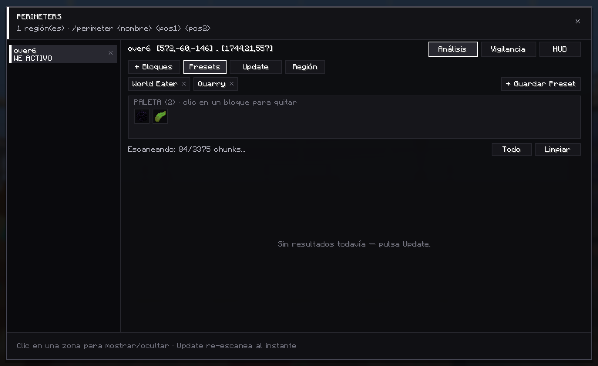

# Perímetros y World Eater (`/perimeter`)

Herramienta para definir regiones de perímetros, escanear bloques problemáticos mediante paletas configurables, visualizar guías 3D in-game y monitorear el avance de un **World Eater**.



---

## 1. Requisitos, Reglas y Límites

| Elemento | Valor |
| --- | --- |
| **Regla Carpet** | `commandPerimeters` (`false` por defecto) |
| **Límite de nombre** | Minúsculas, números, `_` o `-` (máximo **48 caracteres**) |
| **Límite de volumen** | Máximo **200,000,000 bloques** por perímetro |

---

## 2. Comandos

```text
/perimeter
/perimeter <nombre> <pos1> <pos2>
```

- `/perimeter`: Abre la interfaz visual de Perímetros.
- `/perimeter <nombre> <pos1> <pos2>`: Crea o redefine un perímetro en tu dimensión actual entre `pos1` y `pos2`.

---

## 3. Pestaña: Análisis

1. **Lista de perímetros (barra lateral):**
   - Selecciona cualquier perímetro para inspeccionar sus coordenadas y dimensión.
   - Usa **Región** (o editar límites) para ajustar `X1, Y1, Z1` y `X2, Y2, Z2` directamente desde la UI.
2. **Paleta de bloques y Presets:**
   - **+ Bloques:** Abre el selector visual de bloques para añadir o quitar bloques objetivo (por ejemplo: obsidiana, lava, agua, cofres, spawners).
   - **Presets / + Guardar Preset:** Guarda combinaciones frecuentes (ej. `World Eater`, `Quarry`) para reutilizarlas en otros perímetros.
3. **Escaneo incremental (`Update`):**
   - Escanea por chunks sin congelar el servidor (`Escaneando: X/Y chunks...`).
   - Agrupa los bloques encontrados en **clusters** ordenados por distancia respecto a tu posición.
   - Permite activar **guías 3D** en el mundo para localizar los clusters restantes rápidamente.
4. **HUD pineado (`HUD`):**
   - Muestra en la esquina superior derecha el perímetro fijado, el estado del World Eater (`WE: ON`) y los clusters más cercanos con su distancia.

---

## 4. Pestaña: Vigilancia (World Eater) y AeternumBot

- Configura la **Y objetivo** (altura mínima que debe alcanzar la excavación) y el **tiempo de estancamiento (segundos)** sin progreso antes de disparar una alerta de atasco.
- Gestiona la **grilla de bots espectadores** (posicionados en `Y=128`) para mantener cargada el área del perímetro mientras trabaja el World Eater.

### Integración con AeternumBot (Alertas en Discord)
Las alertas de vigilancia están pensadas para conectarse con el plugin `Plugins/world-eater.py` de **AeternumBot**:

1. `AeternumCarpet` emite los eventos de progreso/estancamiento/finalización en el log del servidor con el marcador `[AeternumCarpet] [WE] `.
2. `AeternumBot` captura esos eventos y publica embeds de alerta en el canal configurado en `WorldEater.Channel ID` (desde `/config` en el bot).
3. Cada embed incluye botones persistentes para que los jugadores se suscriban por **Ping** en el canal o por **DM** (si `WorldEater.Allow DM` está habilitado).
