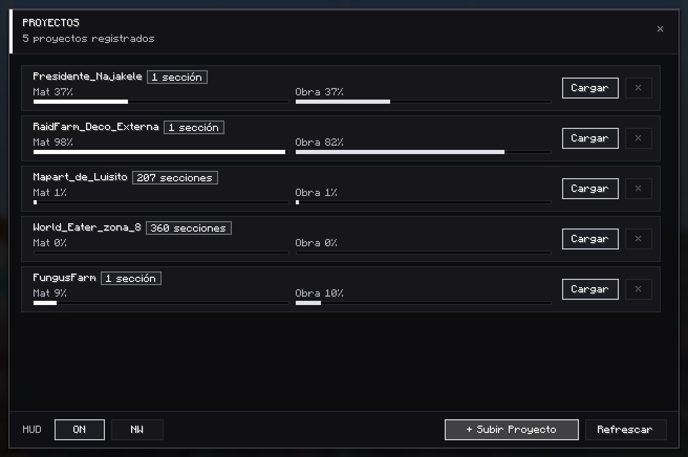
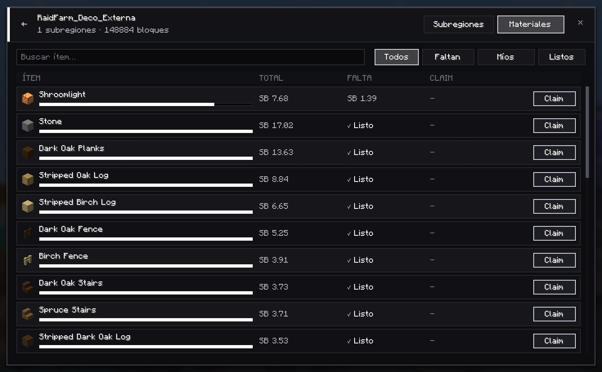
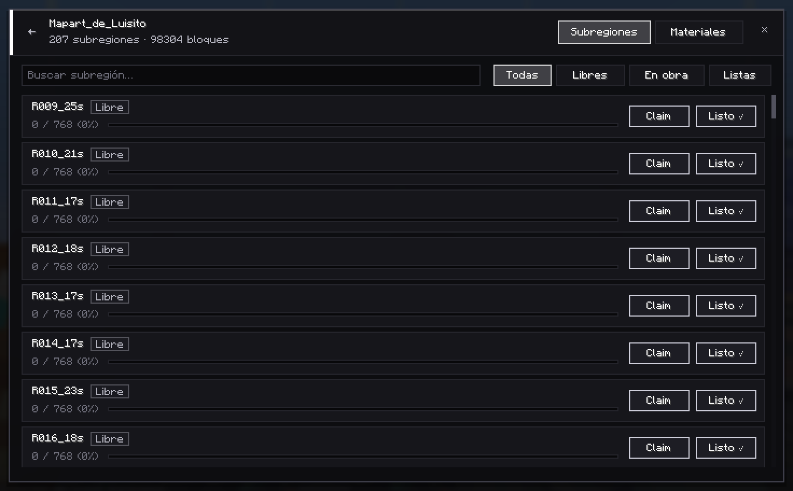

# Proyectos y Materiales (`/projects`)

Sistema colaborativo para subir planos `.litematic` al servidor, seguir el progreso de recolección de materiales y construcción por subregiones, reclamar ítems y asociar almacenes automáticos.

| Lista de Proyectos | Materiales | Subregiones |
| --- | --- | --- |
|  |  |  |

---

## 1. Requisitos, Reglas y Permisos

| Elemento | Valor |
| --- | --- |
| **Regla Carpet** | `commandProjects` (`false` por defecto) |
| **Abrir interfaz** | `/projects` — Disponible para todos cuando `commandProjects=true`. |
| **Subir proyectos (`+ Subir Proyecto`)** | Requiere **OP nivel 2** y tener el archivo `.litematic` en el cliente (integración con Litematica). |
| **Gestión de almacenes (`/projects storage`)** | Requiere **OP nivel 2**. |

---

## 2. Flujo de Uso en la Interfaz

### Lista Principal (`/projects`)
Cada tarjeta muestra el nombre del proyecto, cantidad de secciones/subregiones y dos barras de progreso:
- **Mat %:** Porcentaje de materiales ya recolectados o disponibles.
- **Obra %:** Porcentaje de bloques colocados en el mundo respecto al esquemático.
- **Cargar:** Descarga y alinea el plano directamente en tu cliente de Litematica.

### Footer y HUD en Pantalla
- **HUD `ON` / `OFF`:** Activa o desactiva el overlay flotante con tus materiales reclamados pendientes.
- **Posición (`NW`, `N`, `NE`, `E`, `SE`, `S`, `SW`, `W`):** Rota en qué esquina o borde de la pantalla se muestra el HUD.
- La configuración del HUD se guarda en el cliente en `config/aeternum-carpet/hud.json`.

### Vista de Detalle: Materiales y Subregiones
Al entrar en un proyecto puedes alternar entre dos pestañas:
- **Materiales:**
  - Filtros: `Todos`, `Faltan`, `Míos`, `Listos` + buscador por nombre de ítem.
  - Unidades: `SB` = Shulker Box (**1,728 ítems**), `SDC` = Cofre doble de shulkers (**54 SB**).
  - **Claim:** Reclama un material para que aparezca en tu HUD personal y el resto del equipo sepa quién lo está reuniendo.
- **Subregiones:**
  - Filtros: `Todas`, `Libres`, `En obra`, `Listas`.
  - Permite reclamar secciones (`Claim`) y marcarlas como completadas (`Listo ✓`).

---

## 3. Almacenes Asociados (`/projects storage`)

Los administradores (OP nivel 2) pueden vincular una región física de cofres/shulkers a un proyecto para que el conteo de materiales se actualice automáticamente:

```text
/projects storage list
/projects storage add <nombre_proyecto> <pos1> <pos2>
/projects storage del <nombre_proyecto> <indice>
```

> [!NOTE]
> Cada proyecto admite **un almacén asignado** a la vez. Si necesitas cambiarlo, elimínalo primero con `/projects storage del <nombre> 1`.
