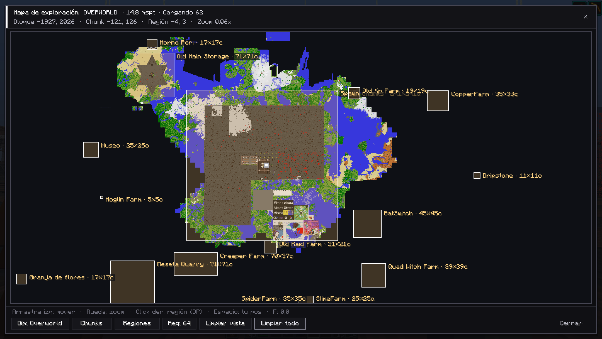

# Mapa de Exploración (`/exploration`)

Mapa interactivo **1 píxel por bloque** gestionado por el servidor para visualizar el terreno generado, controlar qué áreas pueden explorar o generar los jugadores y ejecutar pregeneración de chunks.



---

## 1. Requisitos, Reglas Configurables y Permisos

| Regla | Default | Valores | Descripción |
| --- | --- | --- | --- |
| `explorationManager` | `false` | `true`, `false` | Habilita el comando `/exploration` y el mapa. **Mientras está en `true`, no aplica restricciones de exploración.** |
| `allowPlayerExploration` | `true` | `true`, `false` | Cuando está en `false` (y `explorationManager=false`), restringe la exploración/generación de chunks a las áreas configuradas. |

- `/exploration map`: Abre el mapa visual (requiere `explorationManager=true`).
- `/exploration pregen ...`: Requiere **OP nivel 2**.

---

## 2. Controles del Mapa (`/exploration map`)

### Navegación en el Canvas
- **Arrastrar clic izquierdo:** Mover el mapa.
- **Rueda del mouse:** Hacer zoom.
- **Clic derecho + arrastrar (OP):** Seleccionar o crear una nueva área permitida.
- **Espacio:** Centrar el mapa en tu posición actual.
- **Cabecera superior:** Muestra la dimensión actual, el **MSPT** del servidor en tiempo real, tiles pendientes (`Cargando N`), coordenadas de bloque, chunk, región `.mca` y nivel de zoom.

### Barra Inferior (Configurable)
- **`Dim: Overworld / Nether / End`:** Cambia la dimensión visualizada.
- **`Chunks`:** Muestra u oculta la cuadrícula de chunks (**16×16** bloques).
- **`Regiones`:** Muestra u oculta la cuadrícula de regiones (**.mca 512×512** bloques).
- **`Req: N`:** Ajusta el máximo de tiles solicitados simultáneamente al servidor.
- **`Limpiar vista` / `Limpiar todo`:** Recarga los tiles visibles o limpia la caché de tiles del mapa en esa dimensión.

---

## 3. Pregeneración de Chunks (`/exploration pregen`)

Permite pregenerar las áreas seleccionadas en segundo plano controlando el impacto en el rendimiento:

```text
/exploration pregen start
/exploration pregen pause
/exploration pregen stop
/exploration pregen speed <chunks_por_minuto>
/exploration pregen status
```

- **`chunks_per_minute`:** Entero configurable entre **`1`** y **`1200`** chunks por minuto.
- **`stop`:** Detiene la pregeneración y descarta el progreso pendiente.
- **`status`:** Muestra el estado actual, velocidad y avance.
