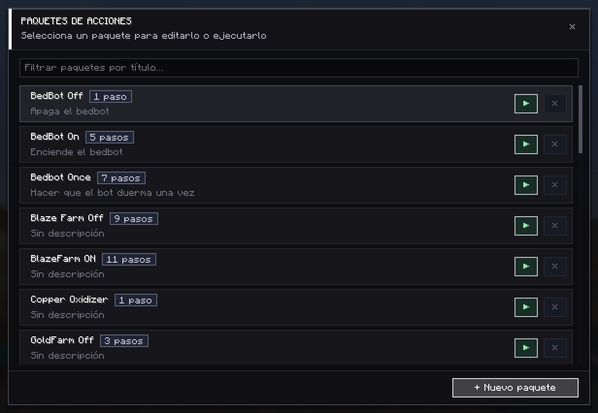
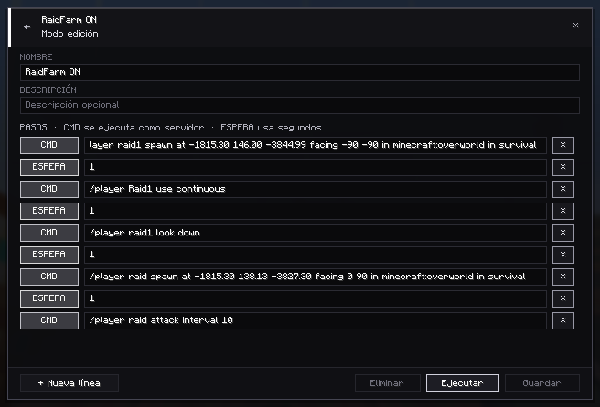

# Paquetes de Acciones (`/actions`)

Editor y lanzador de rutinas de comandos persistentes en el servidor, pensado para encender o apagar granjas con bots, ejecutar mantenimientos o automatizar secuencias con esperas entre pasos.

| Catálogo de Paquetes | Editor de Pasos |
| --- | --- |
|  |  |

---

## 1. Requisitos y Reglas Configurables

| Elemento | Valor |
| --- | --- |
| **Regla Carpet** | `commandActions` (`false` por defecto) |
| **Comando** | `/actions` — Abre la interfaz en el cliente. |
| **Permisos** | Los jugadores autorizados pueden ejecutar paquetes; la creación y edición requiere permisos de edición/OP. |

---

## 2. Catálogo de Paquetes (`/actions`)

- **Filtro superior:** Busca paquetes por título en tiempo real.
- **Tarjetas:** Muestran nombre, cantidad de pasos y descripción opcional.
- **Botón `▶` (verde):** Ejecuta el paquete inmediatamente. Si el paquete ya está corriendo, el servidor evita duplicar la ejecución (`Ese paquete ya se está ejecutando`).
- **Botón `✕`:** Elimina el paquete.
- **+ Nuevo paquete:** Crea un paquete vacío y abre el editor.

---

## 3. Editor de Paquetes

Cada paquete se compone de:
- **Nombre:** Identificador visible en el catálogo.
- **Descripción:** Texto opcional de ayuda.
- **Lista de pasos ordenados:** Cada línea tiene un botón de tipo que alterna entre:
  - **`CMD`:** Comando que se ejecuta con permisos de **servidor** (ejemplo: `/player raid1 spawn at ...`).
  - **`ESPERA`:** Pausa en **segundos** antes de ejecutar el siguiente paso (ejemplo: `1` para esperar 1 segundo antes de enviar `/player raid1 use continuous`).
- **Controles del editor:**
  - **+ Nueva línea:** Añade un paso al final.
  - **`✕`:** Elimina esa línea.
  - **Ejecutar:** Prueba el paquete directamente desde el editor.
  - **Guardar / Eliminar:** Persiste los cambios en el servidor o borra el paquete.
