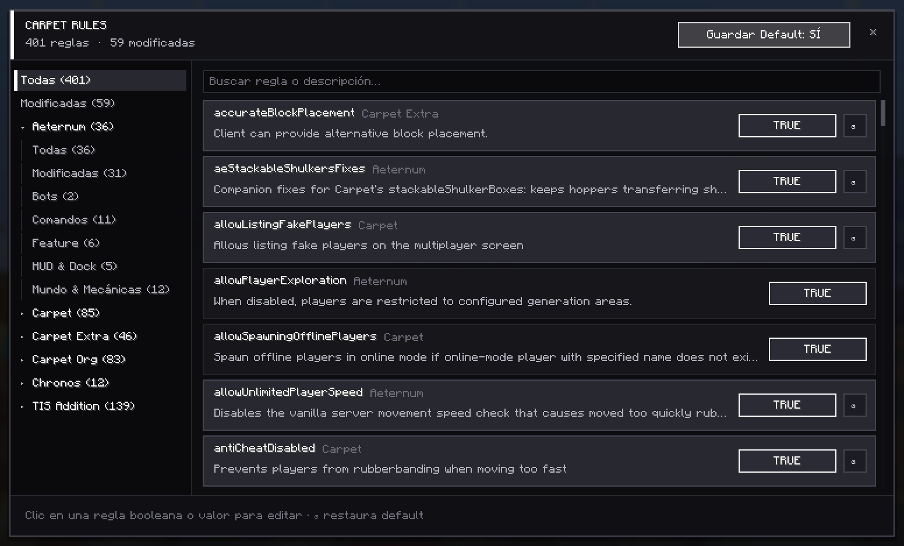

# Reglas de Carpet (`/rules`)

Interfaz visual para buscar, filtrar y modificar en vivo todas las reglas de **Fabric Carpet**, **Aeternum Carpet** y otras extensiones instaladas, con soporte para guardar valores por defecto en `carpet.conf`.

---

## 1. Requisitos y Permisos

| Elemento | Valor |
| --- | --- |
| **Comando** | `/rules` |
| **Permisos** | Requiere **OP nivel 2** y ejecutarse desde el juego. |
| **Equivalente CLI** | `/carpet <regla> <valor>` y `/carpet setDefault <regla> <valor>` |

---

## 2. Navegación y Filtros

### Barra Lateral Izquierda
- **Todas:** Lista completa de reglas cargadas en el servidor.
- **Modificadas:** Muestra únicamente las reglas cuyo valor actual difiere del default.
- **Por Manager / Mod:** Agrupa por `Aeternum`, `Carpet`, `Carpet Extra`, `Carpet Org`, `Chronos`, `TIS Addition`, etc.
- **Subcarpetas de Aeternum:**
  - `Bots` (`reloadFakePlayers`, `editBotInventory`)
  - `Comandos` (`commandStats`, `commandPerimeters`, `commandProjects`, etc.)
  - `Feature`
  - `HUD & Dock` (`quickDock`, `todoList`, `joinMotd`, `explorationManager`, `allowPlayerExploration`)
  - `Mundo & Mecánicas` (`cameraMode`, `updateSuppressionCrashFix`, `instamineDeepslate`, etc.)

### Buscador Superior
Filtra instantáneamente por **nombre de regla** o **descripción**.

---

## 3. Edición y Persistencia (`Guardar Default`)

- **Guardar Default: SÍ / NO (botón superior derecho):**
  - En **`SÍ`** (recomendado para configuración permanente): cada cambio que hagas actualiza la regla en vivo **y** la guarda en `carpet.conf` para que se mantenga tras reiniciar el servidor.
  - En **`NO`**: el cambio se aplica solo en la sesión actual hasta el próximo reinicio.
- **Reglas booleanas:** Haz clic en el botón `TRUE` / `FALSE` para alternarlas al instante.
- **Reglas con opciones o texto (`cameraMode`, `phantomSpawning`, `endermanGriefing`, `updateSuppressionCrashFix`, etc.):** Haz clic en el botón del valor para abrir el editor inline en la parte inferior, escribe o selecciona el valor y pulsa **Aplicar**.
- **Botón `↺` (Reset):** Aparece en las reglas modificadas para restaurarlas a su valor por defecto.
