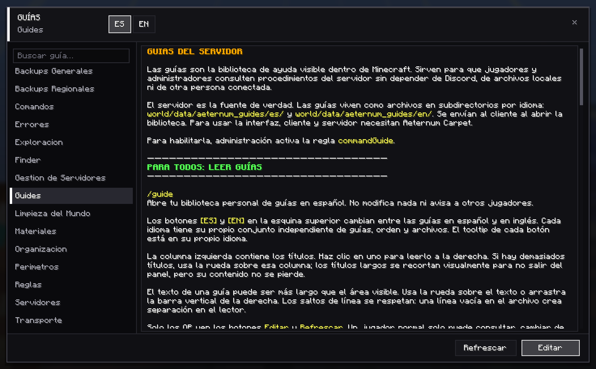

# Guías del Servidor (`/guide`)

Biblioteca interna de documentación dentro de Minecraft con soporte bilingüe (**Español / Inglés**), buscador y editor en vivo para administradores.



---

## 1. Requisitos, Reglas y Almacenamiento

| Elemento | Valor |
| --- | --- |
| **Regla Carpet** | `commandGuide` (`false` por defecto) |
| **Comando** | `/guide` — Abre el lector dentro del juego (cliente y servidor necesitan Aeternum Carpet). |
| **Lectura** | Disponible para **todos los jugadores** cuando `commandGuide=true`. |
| **Edición / Creación** | Solo **OPs** ven los botones `Editar` y `Refrescar`. |
| **Ruta en el servidor** | `world/data/aeternum_guides/es/` y `world/data/aeternum_guides/en/` |

---

## 2. Lectura y Cambio de Idioma

- **Columna izquierda:** Lista de guías ordenadas y buscador superior (`Buscar guía...`) para filtrar por título.
- **Botones `ES` / `EN` (cabecera):** Alternan entre las bibliotecas independientes en español e inglés.
- **Lector derecho:** Respeta saltos de línea y renderiza formato enriquecido.

---

## 3. Edición y Sintaxis de Formato (`MotdMarkup`)

Los administradores pueden editar guías directamente en el juego o modificar los archivos de texto en `world/data/aeternum_guides/<lang>/` y pulsar **Refrescar**.

El formato utiliza tokens con barra invertida (`\`):
- **Colores:** `\black`, `\dark_blue`, `\dark_green`, `\dark_aqua`, `\dark_red`, `\dark_purple`, `\gold`, `\gray`, `\dark_gray`, `\blue`, `\green`, `\aqua`, `\red`, `\light_purple`, `\yellow`, `\white`
- **Estilos:** `\bold`, `\italic`, `\underline`, `\strikethrough`, `\obfuscated`, `\reset`

**Ejemplo:**
```text
\gold\boldGUÍAS DEL SERVIDOR\reset

Para habilitarla, administración activa la regla \yellowcommandGuide\reset.
```
