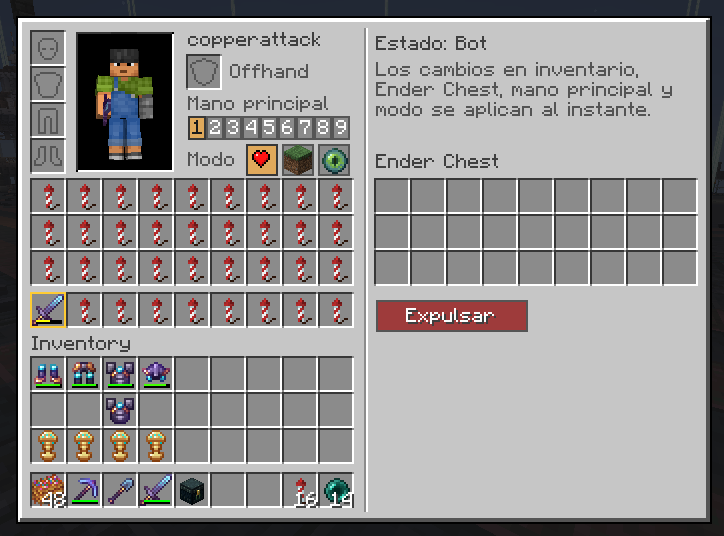

# Inventario de Bots e Inspección (`/viewinv` y `editBotInventory`)

Permite inspeccionar y editar en tiempo real el inventario, armadura, offhand, Ender Chest, ranura de mano principal y modo de juego de **bots de Carpet**, **jugadores online** y **jugadores offline (`.dat`)**.

---

## 1. Requisitos y Reglas Configurables

| Regla | Default | Qué habilita | Permisos |
| --- | --- | --- | --- |
| `editBotInventory` | `false` | Abrir y editar el inventario de un fake player haciendo **clic derecho** sobre el bot. | Jugadores en el mundo. |
| `commandViewInventory` | `false` | Habilita `/viewinv <jugador>` para abrir la interfaz sobre bots, jugadores online u offline. | Requiere **OP nivel 2**. |

---

## 2. Controles de la Interfaz

1. **Armadura y Modelo 3D (arriba a la izquierda):**
   - Ranuras de casco, pechera, pantalones y botas, junto a la vista 3D del bot/jugador.
2. **Offhand y Mano Principal (`1–9`):**
   - Slot de **Offhand** (escudo/tótem) y selector numérico **`1` al `9`** para elegir qué slot de la hotbar sostiene el bot en la mano principal.
   - El slot activo se resalta con borde dorado en la hotbar.
3. **Modo de Juego (`Modo`):**
   - Botones de icono para cambiar al instante entre **Survival** (corazón), **Creativo** (bloque de césped) y **Espectador** (Ojo de Ender).
   - El botón de Creativo solo está habilitado si tienes permisos para asignarlo.
4. **Inventario (27 + 9) y Ender Chest (27):**
   - Todos los cambios en inventario, Ender Chest, mano principal y modo **se aplican al instante**.
5. **Estado y Expulsión:**
   - Muestra si es `Bot`, `Online` u `Offline`.
   - Botón **Expulsar** (rojo): desconecta al bot del servidor.
